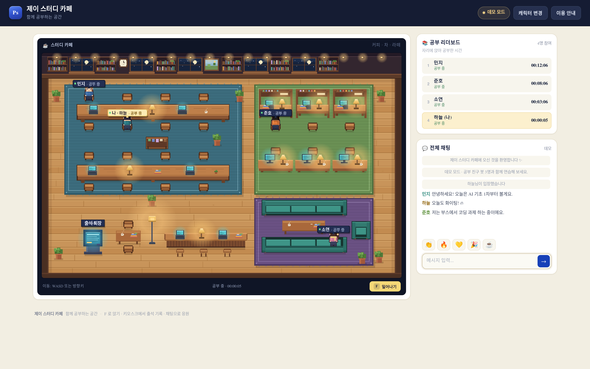

# 제이 스터디 카페 ☕

함께 공부하는 공간, **실시간 2D 픽셀아트 온라인 스터디 카페**입니다.
설치나 빌드 없이 `index.html` 하나로 열리는 정적 웹앱이고, Supabase 키를 넣으면 여러 명이 실시간으로 함께 쓸 수 있습니다.
그림은 전부 코드로 그립니다(이미지 파일 0개).

🔗 라이브: <https://eduthinking.github.io/jey-study-cafe/>



---

## 1. 무엇이 들어 있나

```
study-cafe/
├─ index.html          화면 구조(헤더 · 카페 캔버스 · 리더보드 · 채팅 · 모달)
├─ style.css           크림색 종이 + 네이비 프레임 UI, 반응형·모바일 조작
├─ app.js              게임 루프, 이동·좌석·타이머·채팅·키오스크, 실시간 연동
├─ sprites.js          픽셀아트 엔진(벽·바닥·러그·가구·캐릭터 10종·이름표)
├─ config.js           카페 이름, 출석 회차, 캐릭터, 봇, Supabase 키
├─ supabase-schema.sql 실시간 모드용 테이블·RLS·Realtime 설정
└─ README.md
```

### 카페 안에서 할 수 있는 일
- **이동**: WASD / 방향키, 캔버스를 클릭하면 그 자리로 걸어갑니다. 모바일은 화면 왼쪽 아래 화살표 버튼.
- **앉기·일어나기**: 의자 가까이 가면 `F` 프롬프트가 뜹니다. `F` 키 또는 오른쪽 아래 버튼으로 앉고 일어납니다. 의자를 직접 클릭해도 그 자리로 걸어가 앉습니다.
- **공부 타이머**: 자리에 앉아 있는 동안에만 리더보드의 `HH:MM:SS`가 올라갑니다. 일어나면 `자리 비움`.
- **출석·퇴장 키오스크**: 아래쪽 파란 화면 앞에서 `F` → 1~5회차(설정 가능) 출석·퇴장을 시각과 함께 기록합니다.
- **채팅·응원**: 전체 채팅, 빠른 이모지 👏 🔥 💛 🎉 ☕ (내 캐릭터 위로 이모지가 떠오릅니다).
- **캐릭터 변경**: 헤더의 `캐릭터 변경` → 10종 중 다시 선택.

### 공간 구성
| 구역 | 러그 | 내용 |
|---|---|---|
| 공용 스터디 존 | 파란 러그 | 긴 원목 테이블 2개 · 노트북 · 스탠드 조명 · 16석 |
| 개인 집중 부스 | 초록 러그 | 칸막이 부스 3개 + 오픈 데스크 3개 · 6석 |
| 라운지 | 보라 러그 | 소파 2개 · 암체어 · 커피 테이블 · 7석 |
| 창가 티 테이블 | — | 2인석 · 스탠드 조명 |
| 바 카운터 | — | 노트북 바 좌석 3석 |
| 키오스크 | — | 출석·퇴장 기록 |

---

## 2. 바로 실행하기

정적 파일이라 `index.html`을 열면 되지만, 브라우저 보안 정책 때문에 **로컬 서버**로 여는 것을 권합니다.

```bash
cd study-cafe
python3 -m http.server 8080
# 브라우저에서 http://localhost:8080
```

처음 열면 `캐릭터를 선택하세요` 창이 뜹니다. 닉네임을 적고 캐릭터를 고르면 입장합니다.
키가 비어 있으면 자동으로 **데모 모드**로 동작합니다.

---

## 3. 두 가지 모드

### 데모 모드 (기본값 · 설정 필요 없음)
- `config.js`의 `supabase.url`, `supabase.anonKey`가 비어 있을 때.
- 내 브라우저 안에서만 돌아갑니다.
- 공부 친구 봇 3명(**민지 · 준호 · 소연**)이 각자 구역에 앉아 공부하고, 가끔 채팅을 겁니다. 봇의 공부 시간도 함께 올라갑니다.
- 내 출석 기록은 `localStorage`(`jey-study-cafe:attendance`)에 저장됩니다.
- 리더보드의 봇 시간은 화면을 채우기 위한 예시 값(12분·8분·3분)에서 시작합니다.

### 실시간 모드 (Supabase)
1. <https://supabase.com> 에서 새 프로젝트를 만듭니다.
2. **SQL Editor** 에 `supabase-schema.sql` 전체를 붙여넣고 실행합니다.
3. **Project Settings → API** 에서 `Project URL` 과 `anon public` 키를 복사해 `config.js`에 넣습니다.

```js
supabase: {
  url: 'https://xxxxxxxxxxxx.supabase.co',
  anonKey: 'eyJhbGciOiJIUzI1NiIsInR5cCI6IkpXVCJ9....',
},
```

4. 페이지를 새로고침하면 헤더 배지가 **실시간 연결**(초록 점)로 바뀝니다.

동작 방식
- **Presence**: 참가자의 닉네임·캐릭터·좌표·앉은 자리·공부 시간을 2.5초마다 공유해 서로의 캐릭터가 같은 화면에 보입니다.
- **Broadcast**: 채팅과 이모지 반응을 즉시 전달합니다.
- **Postgres**: `chat_messages`(최근 24개를 입장 시 불러옴), `attendance_logs`(키오스크 기록)에 저장합니다.
- 연결에 실패하면 알림을 띄우고 자동으로 데모 모드로 넘어갑니다.

> `anon` 키는 공개되어도 되는 키입니다. 쓰기 권한은 위 스키마의 RLS 정책으로 insert/select만 열어 두었습니다.
> 닉네임만 쓰는 가벼운 카페이므로 **로그인·비밀번호는 없습니다.** 사적인 대화는 남기지 마세요.

---

## 4. 꾸미기

`config.js`만 고치면 됩니다.

```js
title: '제이 스터디 카페',      // 헤더 제목·페이지 제목
subtitle: '함께 공부하는 공간',
kioskRounds: 5,                // 1~5회차 → 3, 10 등으로 변경
movement: { speed: 104 },      // 걷는 속도(px/초)
chat: { quickReactions: ['👏','🔥','💛','🎉','☕'] },
```

- **캐릭터 추가/수정**: `characters` 배열. `hairStyle`(`bob` `short` `long` `ponytail` `bun` `afro` `beanie` `cap` `hood`), `accessory`(`none` `glasses` `headphones` `scarf`), 색상 6종만 바꿔도 새 캐릭터가 됩니다.
- **봇 추가**: `demoBots` 배열에 `{ name, charId, zone, lines }`. `zone`은 `shared` · `focus` · `lounge`.

---

## 5. 배포

### GitHub Pages
```bash
# 저장소 루트에 이 폴더의 파일들이 오도록 올립니다
git init
git add .
git commit -m "제이 스터디 카페"
git branch -M main
git remote add origin https://github.com/<사용자>/jey-study-cafe.git
git push -u origin main
```
저장소 → **Settings → Pages → Source: Deploy from a branch → Branch: `main` / `(root)`** 를 선택하면
`https://<사용자>.github.io/jey-study-cafe/` 에서 열립니다.

> 실시간 모드를 쓸 때는 Supabase 대시보드 **Authentication → URL Configuration** 의 Site URL / Redirect URL 에
> 배포 주소를 추가해 두세요.

### 그 밖의 정적 호스팅
Netlify, Vercel, Cloudflare Pages 등에 `study-cafe/` 폴더를 그대로 올리면 됩니다(빌드 명령 없음, 출력 디렉터리 = 루트).

---

## 6. 참고

- **캔버스 해상도**: 논리 좌표 640×400을 2배(1280×800)로 그린 뒤 CSS로 확대합니다. `image-rendering: pixelated` 로 픽셀을 살립니다.
- **글꼴**: 별도 웹폰트를 받지 않고 시스템 한글 글꼴(Pretendard → Apple SD Gothic Neo → Noto Sans KR → Malgun Gothic)을 씁니다.
- **모바일**: 좁은 화면에서는 사이드 패널이 아래로 내려가고, 캔버스 위에 방향 버튼과 `F` 버튼이 나타납니다.
- **접근성**: 모달은 `role="dialog"`, 채팅은 `aria-live`, `prefers-reduced-motion` 을 존중합니다.
- **테스트**: `window.CAFE_DEBUG` 로 상태(`state`)·좌석(`seats`)·지도(`map`)를 확인할 수 있습니다.
